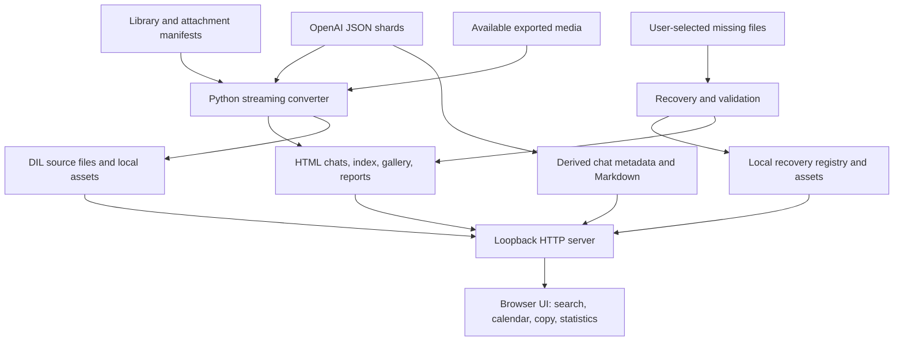

# ChatGPT Local Archive

**A local-first viewer and file-recovery toolkit for official ChatGPT data exports.**

ChatGPT Local Archive converts exported conversation JSON, attachment manifests and available media into a searchable HTML archive. It is designed for people who want to inspect, preserve and navigate their own conversation history, including exports with incomplete file references.

**Current release:** `7.3.16.1` (stable user-validated feature set; incomplete support for Intelligent UI). **Author:** [Dmitro Melnikov](https://github.com/dmitromelnikoff).

**Documentation:** [Русский README](README.ru.md) · [Original Russian installation guide](README_START_HERE_RU.md) · [Architecture](docs/ARCHITECTURE.md) · [Limitations](docs/KNOWN_LIMITATIONS_RU.md)

> Independent community project. Not an official OpenAI product or a native implementation of the ChatGPT interface. The generated archive contains private user data: **never publish it to GitHub**.

## Why this exists

Official data exports contain conversation trees rather than ready-to-view pages. Message branches, generated files and `library_files.json` references do not always identify a single visible response, and some files may be missing. Browser-only file URLs are also insufficient for certain local viewer behaviors.

This project provides a **readable, local** representation and documents which file placements are exact, inferred or unresolved. It does not invent the bytes of missing attachments.

## Features

| Area | Implemented behavior |
| --- | --- |
| Conversion | Streaming extraction of `conversations*.json` shards into individual HTML chats and a searchable index. |
| Navigation | Virtualized chat list, text search, calendar by **last updated month**, per-chat user-question navigation. |
| Archive overview | Counts and statistics derived from available indexes, reports and recovery state. |
| Attachments | Media extraction, image gallery, complete generated-files list, binding reports, visible unresolved references. |
| Recovery | Manual restore of missing files through a loopback HTTP server; local registry and conservative HTML/link repair. |
| Reading | Markdown, tables, code, SVG, MathJax formulas, best-effort static DIL/Intelligent UI, readable Markdown mode. |
| Copy / export | Copy a prompt, answer, code block or whole conversation; export the main conversation as Markdown named after its title. |
| Metadata | Per-chat question/image counts; `archived` indicator only when explicitly present in source metadata. |
| Original link | Open original conversation on chatgpt.com when a valid original conversation ID is available. |

Some generated-image associations use heuristics and should not be treated as certain. See [technical findings](docs/TECHNICAL_FINDINGS_RU.md).

## Architecture



The converter and interface modules intentionally live at the **repository root**. They resolve paths relative to their own files; moving them into `src/` without refactoring would break the existing installer and viewer. The original Russian language of the program is retained.

## Technology

- **Python 3.9+**, primarily the standard library (`http.server`, `json`, `csv`, `pathlib`, `html.parser`).
- **Vanilla JavaScript, HTML and CSS** for the browser UI.
- Vendored **Mistune 3.2.1** (BSD-3-Clause) for Markdown, and **MathJax** (Apache-2.0) for formulas; original third-party license texts are included.
- **No database, remote API key, or pip installation required** for the packaged release.

See [third-party notices](docs/THIRD_PARTY_NOTICES.md). This repository's own license has **not yet been selected**; the bundled libraries retain their respective licenses.

## Repository layout

```text
chatgpt-local-archive/
├── README.md / README.ru.md
├── chatgpt_local_archive.py        # JSON → local HTML converter
├── build_from_export.py            # guarded full build
├── serve_archive.py               # token-scoped localhost viewer
├── archive_recovery.py            # missing-file recovery
├── archive_chat_exports.py        # Markdown and chat metadata
├── archive_render_v7.py           # Markdown / static DIL renderer
├── intelligent_ui_markdown.py     # readable UI alternative
├── archive_calendar_stats.js/.css # calendar and statistics
├── archive_chat_actions.js        # prompt, code and chat actions
├── archive_chat_list_meta.js      # per-chat summary counters
├── install_*.py                   # post-build UI setup
├── viewer/                         # vendored MathJax runtime
├── vendor/mistune/                 # vendored Markdown parser
├── tests/                          # synthetic, private-data-free checks
└── docs/                           # architecture and original research notes
```

Other original modules, `.bat`/`.sh` launchers and reports remain in the root for compatibility. **User exports, generated archives and recovered files are excluded** by `.gitignore` and are not part of the repository.

## Quick start

**Requirements:** Python 3.9 or newer; a locally extracted **official ChatGPT data export**.

1. Clone or download the repository.
2. Put the export files (`conversations-000.json`, other shards, optional manifests and exported `file_*.dat` assets) in the **same directory as `build_from_export.py`**. The program currently uses script-relative paths, not a configurable `--input` location. Keep these data files private.
3. Build once:

   **Windows:** run `01_BUILD_ARCHIVE.bat`.

   **Linux/macOS:** run `sh build_archive.sh`.

4. Open the viewer:

   **Windows:** run `02_OPEN_ARCHIVE.bat`.

   **Linux/macOS:** run `sh open_archive.sh`.

5. The browser opens a session-specific URL on **`127.0.0.1`**. Keep the server process running while viewing the archive.

**Do not open the generated HTML via `file://`**; dynamic scripts and recovery are designed for the local server.

**Never rerun a full build over an archive with restored files without a backup.** The build launcher refuses to overwrite an existing `ChatGPT_Local_Archive/index.html` by default. For the supported post-build interface refresh, use `10_REFRESH_INTERFACE.bat` or `python refresh_ui_only.py`.

### Example CLI workflow

```bash
python3 check_package.py
python3 build_from_export.py
python3 serve_archive.py ChatGPT_Local_Archive --no-browser
```

The final command prints a one-time local URL. File recovery requires using this local HTTP server. Restoring one missing file uses the **Restore** action in the generated file list and saves the result locally.

## Testing

Run the dependency-free synthetic smoke tests:

```bash
python3 -m unittest discover -s tests -v
python3 check_package.py
```

Where Node.js is available, JavaScript syntax can also be checked with `node --check <file.js>`. The smoke tests do **not** use real chat histories and do not require network access. Historical release checks and the user's manual confirmation of the installed incremental `7.3.16.1` update are documented separately; neither constitutes an exhaustive test of every real export or a pixel-perfect UI compatibility claim. See [testing guide](docs/TESTING.md).

## Security and privacy

- Conversion is local. The viewer binds to the loopback address with a per-session token in its URL; this is **not** a hardened multi-user web service.
- Never commit `conversations*.json`, `library_files.json`, `.dat` media, `ChatGPT_Local_Archive/`, `ChatGPT_Generated_Files/` or `recovered_files.json`.
- The README contains **no real user export data**, passwords or API tokens. Even with `.gitignore`, manually review staged files before pushing.
- Exported conversations can contain untrusted markup and sensitive data; use the viewer only with archives you trust, preferably on your own machine.
- External ChatGPT links are opened only when explicitly requested.

More detail: [Security and privacy](docs/SECURITY_AND_PRIVACY.md).

## Known limitations

- DIL / Intelligent UI is **best-effort**, not OpenAI's closed native renderer. Some dynamic widgets and formatting remain incomplete.
- Ambiguous attachment mappings use documented heuristics, and unavailable exported files cannot be reconstructed without original bytes.
- A calendar month groups conversations by last update time, not per-message activity.
- Markdown export focuses on the selected conversation path and excludes tool/reasoning service messages; attachment paths may need adjustment if the `.md` is moved.
- The integrated browser has not been proven pixel-equivalent across all platforms or the full size of the user's private archive.
- The existing UI and most original installation messages are in Russian. English UI localization is a future milestone.

See [known limitations](docs/KNOWN_LIMITATIONS_RU.md) and [roadmap](ROADMAP.md).

## Development status and next steps

`v7.3.16.1` is the **baseline release** for future work. Prior iterations are documented in Russian, but this repository does not claim a reconstructed series of historical Git commits. Priorities include reproducible tests for diverse exports, security hardening, a structured AST-based DIL renderer, and RU/EN UI localization. Track future changes in [CHANGELOG.md](CHANGELOG.md).

## Authorship

**Dmitro Melnikov** — project author and maintainer.

GitHub: [@dmitromelnikoff](https://github.com/dmitromelnikoff)

This project is independent of OpenAI and is not endorsed by OpenAI.
