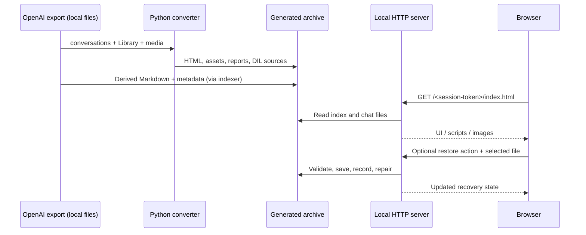

# System architecture

## Scope

ChatGPT Local Archive is a **local offline-capable archival viewer**, not a GPT agent, prompt orchestration framework or chatbot model. It processes user-provided official exports and makes them browseable. It does not issue LLM inference requests. The optional external ChatGPT conversation link is initiated by the user.

## Data pipeline

1. **Input discovery:** `chatgpt_local_archive.py` finds `conversations-*.json` or `conversations.json` next to the script. It reads conversation objects incrementally using `StreamJSON`.
2. **Graph traversal:** `ordered_nodes` follows the selected `current_node` ancestry; additional branches may be displayed separately. Roles, channels and metadata distinguish readable turns and service records.
3. **Attachment binding:** The converter combines manifest/Library IDs, message references, `metadata.parent_id` and the mapping ancestry. Stronger links are preferred; ambiguous temporal matches remain labeled as inferred or unresolved. When certain images have no visible assistant answer, conservative synthetic result cards may be inserted.
4. **Static output:** The converter writes `ChatGPT_Local_Archive/index.html`, `chats/`, `gallery/`, `assets/`, `dil_sources/`, CSV reports and `generated_files.html`.
5. **Derived output:** `archive_chat_exports.py` builds `chat_metadata_index.json` and Markdown exports from the original JSON instead of copying browser DOM. The calendar uses the latest conversation timestamp; `archived` is taken from real source metadata.
6. **Post-build UI:** `install_calendar_statistics.py` and `install_chat_actions.py` idempotently add the relevant assets to the generated index. The interface scripts do not require the original multi-gigabyte export at page-view time.
7. **Local server:** `serve_archive.py` binds to `127.0.0.1` using a random capability-token URL. It serves generated pages, injects per-chat UI scripts at response time, delivers Markdown and handles manual file recovery. It is not designed to be Internet-facing.
8. **Recovery:** `archive_recovery.py` validates a user-selected local file, copies it into locally managed folders, updates `recovered_files.json` and repairs known HTML/link placeholders. Where evidence is missing, it avoids arbitrary assignments.

## Modules and responsibilities

| File | Responsibility |
| --- | --- |
| `build_from_export.py` | Top-level guarded build pipeline. |
| `chatgpt_local_archive.py` | Streaming conversion and asset binding. |
| `archive_render_v7.py` | HTML/Markdown/static DIL rendering. |
| `dil_template_safe.py`, `intelligent_ui_markdown.py` | Limited template expansion and alternate DIL reading mode. |
| `archive_recovery.py`, `recovery_source_links.py`, `repair_recovered_chats.py` | Asset recovery and linking. |
| `archive_chat_exports.py` | Derived Markdown and per-chat metrics. |
| `serve_archive.py` | Local HTTP endpoints and script injection without rewriting chat pages. |
| `archive_*js`, `copy_answers.js`, `question_navigation.js` | Client interactions and navigation. |
| `vendor/mistune/`, `viewer/mathjax-tex-svg.js` | Bundled third-party Markdown/math runtimes. |

## Data preservation and state

- **Source of truth:** personal JSON/media from the OpenAI export, never rewritten by the normal conversion path.
- **Derived build:** HTML pages, reports, metadata, Markdown and cached assets under `ChatGPT_Local_Archive/`.
- **Mutable state:** `recovered_files.json`, recovered media and HTML patch backups. These are *user data* and must be backed up.
- **Server state:** token and port change per run; not committed.
- **No database, external API credential, vector store, model memory, multi-agent runtime or prompt design layer** in this version.

## Important boundaries

- Do **not** treat generated/inferred Library matches as verified identities.
- Do **not** execute arbitrary JavaScript embedded in exported DIL as a substitute for a renderer.
- Keep the existing root-relative layout until imports, launchers and smoke tests have been migrated deliberately.
- Do not commit the generated archive or private inputs to GitHub.

See [original technical findings (RU)](TECHNICAL_FINDINGS_RU.md) and [security review](SECURITY_AND_PRIVACY.md).
